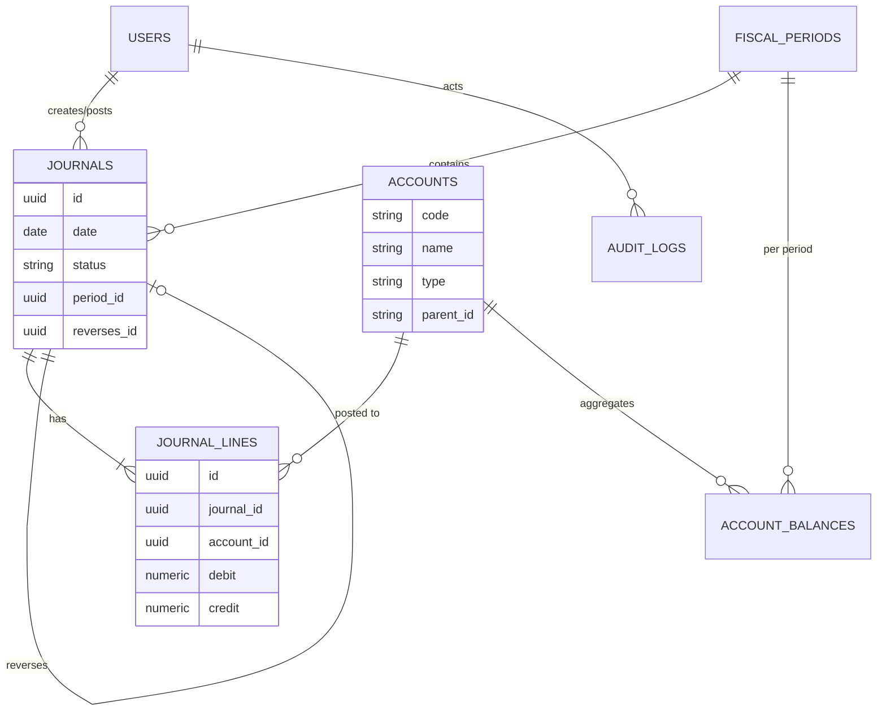

# Kế hoạch phát triển — Accounting Ledger

> Phần mềm tài chính kế toán (double-entry accounting ledger) dùng làm lõi cho ERP / hệ thống tài chính.
> Tài liệu này là roadmap kỹ thuật chi tiết, bám sát `Details-develop.txt`, `Stack-tecnical.txt` và `Future-project.txt`.

---

## 1. Mục tiêu & phạm vi

**Mục tiêu:** Xây một lõi kế toán kép (double-entry) đúng đắn về mặt nghiệp vụ, an toàn dữ liệu và có thể mở rộng thành ERP hoặc hệ thống thanh toán.

**Trong phạm vi (MVP → v1.0):**
- Chart of Accounts (hệ thống tài khoản), Fiscal Period (kỳ kế toán).
- Journal Entry (bút toán) với vòng đời: nháp → xác nhận → ghi sổ.
- General Ledger, số dư tài khoản, Trial Balance (bảng cân đối thử).
- Đảo bút toán (reversal) bằng chứng từ điều chỉnh — **không xóa lịch sử đã ghi sổ**.
- Khóa kỳ kế toán (period close).
- Audit trail, phân quyền (người lập / người duyệt / người ghi sổ).
- Báo cáo: KQKD, bảng cân đối kế toán, lưu chuyển tiền tệ.

**Ngoài phạm vi (giai đoạn sau):** Mini ERP (mua/bán hàng, công nợ, thuế, đa tiền tệ) và Payment & Reconciliation — xem mục 12.

**Người dùng mục tiêu:** kế toán viên, kế toán trưởng, kiểm toán viên nội bộ, chủ doanh nghiệp.

---

## 2. Tech stack (chốt)

| Lớp | Công nghệ | Ghi chú |
|---|---|---|
| Frontend | **Vite + React 19 + TypeScript** | SPA; react-router, TanStack Query, Zustand, Zod, Recharts |
| Backend | **NestJS 12 + TypeScript (ESM)** | REST API, DI, guards/interceptors |
| Database | **PostgreSQL 16** | Qua TypeORM; dùng transaction + constraint |
| Queue | **Redis 7 + BullMQ** (`@nestjs/bullmq`) | Xử lý bất đồng bộ, retry, webhook, job định kỳ |
| Schedule | **`@nestjs/schedule`** | Cron: chốt số dư, đối soát, nhắc nợ, đóng kỳ |
| Cache/KV | **Redis** | Idempotency key, lock, cache báo cáo |
| API docs | **Swagger / OpenAPI** (`@nestjs/swagger`) | Tự sinh tại `/api/docs` |
| Auth | Passport + JWT + bcryptjs | RBAC theo vai trò kế toán |
| Test | Vitest (unit/integration), supertest (e2e) | + test đồng thời (concurrency) |
| Hạ tầng | Docker Compose, CI/CD, structured logging, metrics | Xem mục 9 |

> **Quy tắc vàng về tiền:** KHÔNG dùng `float`/`number` cho tiền. Dùng `NUMERIC(19,4)` trong PostgreSQL và `Decimal` (thư viện `decimal.js`) ở tầng ứng dụng. Không bao giờ tính tiền bằng phép toán số thực nhị phân.

---

## 3. Kiến trúc tổng thể

```
┌─────────────────────────┐        ┌──────────────────────────────────────┐
│   Frontend (Vite React) │  HTTP  │            Backend (NestJS)          │
│  - SPA kế toán           │ ─────▶ │  Controllers → Services → Repos      │
│  - Query cache           │  /api  │  Guards (RBAC) · Pipes (validate)     │
│  - Biểu mẫu bút toán     │ ◀───── │  Interceptors (audit, logging)        │
└─────────────────────────┘        └───────────┬───────────────┬──────────┘
                                               │               │
                                     ┌─────────▼──────┐  ┌─────▼──────────┐
                                     │  PostgreSQL    │  │  Redis/BullMQ  │
                                     │  (sổ cái,      │  │  queue + cron  │
                                     │   ledger, ...)  │  │  + idempotency │
                                     └────────────────┘  └────────────────┘
```

**Nguyên tắc kiến trúc:**
1. **Backend là nơi bảo vệ bất biến nghiệp vụ** — cân bằng Nợ/Có, kỳ đã khóa, không ghi trùng. Frontend chỉ là lớp hiển thị/validate sớm.
2. Mọi thao tác ghi sổ chạy trong **một database transaction**.
3. Thao tác có thể bị gọi lại (retry) phải **idempotent**.
4. Dữ liệu đã ghi sổ là **append-only** — sửa sai bằng bút toán đảo/điều chỉnh.

---

## 4. Cấu trúc thư mục (đã scaffold)

```
Accounting Ledger/
├─ Frontend/                 # Vite + React + TS
│  ├─ src/
│  ├─ public/
│  ├─ index.html
│  └─ package.json
├─ Backend/                  # NestJS 12 (ESM)
│  ├─ src/
│  │  ├─ main.ts             # Swagger, CORS, ValidationPipe, global prefix /api
│  │  └─ app.module.ts       # Config + TypeORM(Postgres) + Schedule + BullMQ(Redis)
│  ├─ test/
│  ├─ .env.example           # mẫu biến môi trường (đã copy thành .env)
│  └─ package.json
├─ docker-compose.yml        # PostgreSQL + Redis
└─ DEVELOPMENT_PLAN.md       # tài liệu này
```

**Cấu trúc module Backend đề xuất (sẽ tạo dần):**
```
src/
├─ common/        # filters, interceptors, guards, decorators, pipes
├─ config/        # configuration factories, validation
├─ auth/          # JWT, login, RBAC
├─ users/         # người dùng & vai trò
├─ accounts/      # Chart of Accounts
├─ periods/       # Fiscal Period (mở/khóa kỳ)
├─ journals/      # Journal Entry + Journal Line (vòng đời, ghi sổ, đảo)
├─ ledger/        # General Ledger, số dư, trial balance
├─ reports/       # KQKD, cân đối kế toán, lưu chuyển tiền tệ
├─ audit/         # audit log
└─ jobs/          # BullMQ processors + scheduled tasks
```

---

## 5. Mô hình miền & ERD

### 5.1 Thực thể chính

| Thực thể | Ý nghĩa | Trường then chốt |
|---|---|---|
| `users` | người dùng | id, email, password_hash, role, status |
| `accounts` | tài khoản kế toán | code, name, type (ASSET/LIABILITY/EQUITY/REVENUE/EXPENSE), parent_id, is_postable |
| `fiscal_periods` | kỳ kế toán | year, month/quarter, start_date, end_date, status (OPEN/CLOSED) |
| `journals` | bút toán (header) | id, code, date, description, status (DRAFT/POSTED/REVERSED), period_id, created_by, posted_by, posted_at, reverses_id |
| `journal_lines` | dòng bút toán | id, journal_id, account_id, debit (numeric), credit (numeric), description |
| `account_balances` | số dư tổng hợp | account_id, period_id, opening, debit_total, credit_total, closing |
| `audit_logs` | lịch sử thao tác | id, entity, entity_id, action, actor_id, before, after, at |

### 5.2 ERD (mermaid)



### 5.3 Bất biến dữ liệu (invariants) — phải enforce ở DB + service

1. **Σ debit = Σ credit** cho mỗi bút toán (kiểm tra ở service VÀ ở DB bằng trigger/constraint).
2. Mỗi dòng bút toán chỉ được có **debit XOR credit** (không cả hai, không âm).
3. Bút toán `POSTED` **không được UPDATE/DELETE** — chỉ được đảo bằng bút toán mới.
4. Không ghi sổ vào **kỳ đã CLOSED**.
5. `account_balances` luôn tái lập được từ `journal_lines` (reconciliation test).
6. Bút toán đảo phải **bù trừ chính xác** bút toán gốc và liên kết qua `reverses_id`.

---

## 6. Vòng đời nghiệp vụ

### 6.1 Bút toán (Journal lifecycle)
```
DRAFT ──confirm──▶ CONFIRMED ──post──▶ POSTED ──reverse──▶ REVERSED
  │                                        │
  └──cancel──▶ CANCELLED                   └─(tạo bút toán đảo mới ở trạng thái POSTED)
```
- **DRAFT:** tự do sửa/xóa.
- **CONFIRMED:** chờ duyệt, có thể khóa chỉnh sửa theo quyền.
- **POSTED:** bất biến; cập nhật `account_balances`; ghi audit log.
- **REVERSED:** bút toán gốc được đánh dấu, kèm bút toán đảo.

### 6.2 Khóa kỳ (Period close)
1. Kiểm tra mọi bút toán trong kỳ đã POSTED/CANCELLED.
2. Chốt `opening` cho kỳ kế tiếp = `closing` kỳ này.
3. Đặt `fiscal_periods.status = CLOSED` (thao tác nguyên tử).
4. Từ chối mọi bút toán mới vào kỳ đã đóng.

---

## 7. Lộ trình phát triển theo giai đoạn

> Bám theo khung 8–12 tuần của dự án Accounting Ledger (đối chiếu roadmap 12 tháng trong `Details-develop.txt`).

### Giai đoạn 0 — Foundation (Tuần 1) ✅ *đã xong phần scaffold*
- [x] Cài pnpm, tạo `Frontend` (Vite React TS) và `Backend` (NestJS).
- [x] Cài PostgreSQL/TypeORM, Schedule, BullMQ/Redis, Swagger, Auth, decimal.js.
- [x] Wire `app.module.ts` (Config + Postgres + Schedule + BullMQ) và `main.ts` (Swagger/CORS/Validation).
- [x] `docker-compose.yml` (Postgres + Redis), `.env.example`, `.gitignore`.
- [ ] Ôn lại kiến thức kế toán căn bản: tài sản/nợ/vốn/doanh thu/chi phí, định khoản, 5 loại tài khoản.
- [ ] Lập 20 nghiệp vụ mẫu của công ty giả lập (góp vốn, mua hàng, bán chịu, thu tiền, trả lương...).

**Đầu ra:** repo chạy được, `docker compose up -d` + `pnpm start:dev` (Backend) + `pnpm dev` (Frontend).

### Giai đoạn 1 — Domain & Schema (Tuần 2–3)
- [ ] Thiết kế ERD đầy đủ (mục 5), viết migration TypeORM.
- [ ] Tạo entity: `Account`, `FiscalPeriod`, `Journal`, `JournalLine`, `AccountBalance`, `AuditLog`.
- [ ] Ràng buộc DB: FK, `CHECK (debit >= 0)`, `CHECK (credit >= 0)`, `CHECK (NOT (debit > 0 AND credit > 0))`, unique `accounts.code`.
- [ ] Trigger/constraint kiểm tra cân bằng Nợ/Có ở mức bút toán.
- [ ] Seed dữ liệu demo: hệ thống tài khoản chuẩn (TT200/TT133), vài kỳ kế toán.

**Đầu ra:** ERD, migration, seed; test "tổng Nợ = tổng Có".

### Giai đoạn 2 — Core API (Tuần 4–6)
- [ ] Module `accounts`: CRUD, cây tài khoản, validate chỉ ghi vào `is_postable`.
- [ ] Module `periods`: mở/khóa kỳ, chặn ghi vào kỳ đã đóng.
- [ ] Module `journals`: tạo nháp → xác nhận → ghi sổ (transaction), đảo bút toán.
- [ ] **Idempotency:** header `Idempotency-Key` cho API tạo/ghi sổ (lưu ở Redis).
- [ ] **Concurrency:** khóa `SELECT ... FOR UPDATE` / advisory lock khi cập nhật số dư.
- [ ] Module `ledger`: truy vấn sổ cái theo tài khoản, số dư theo kỳ/khách hàng, trial balance.
- [ ] Swagger đầy đủ + DTO (class-validator).

**Đầu ra:** API chạy được, docs tại `/api/docs`, test tự động + dữ liệu demo.

### Giai đoạn 3 — Auth, Audit & Reports (Tuần 7–8)
- [ ] Module `auth`: đăng nhập JWT, refresh, RBAC (`maker`/`checker`/`poster`/`admin`).
- [ ] Module `audit`: interceptor ghi mọi thao tác thay đổi (before/after, actor, thời điểm).
- [ ] Module `reports`: KQKD, bảng cân đối kế toán, lưu chuyển tiền tệ, trial balance.
- [ ] Cache báo cáo nặng bằng Redis, invalidate khi ghi sổ.
- [ ] Tầng schedule: job định kỳ chốt số dư / kiểm tra bất biến / nhắc nhở.

**Đầu ra:** phân quyền đầy đủ, audit trail, 3 báo cáo tài chính cơ bản.

### Giai đoạn 4 — Frontend (song song Tuần 4–9)
- [ ] Setup router, layout, state (Zustand), data layer (TanStack Query + axios), form (Zod).
- [ ] Màn hình: đăng nhập, danh mục tài khoản, kỳ kế toán.
- [ ] Màn hình bút toán: tạo/sửa nháp, kiểm tra cân bằng realtime (chỉ để UX — backend vẫn là chốt chặn cuối).
- [ ] Màn hình sổ cái, số dư, trial balance, báo cáo (Recharts).
- [ ] **Quy ước hiển thị:** tăng = đỏ, giảm = xanh (chuẩn VN); đơn vị tiền tệ ¥/₫ tùy cấu hình.

**Đầu ra:** SPA kế toán dùng được end-to-end.

### Giai đoạn 5 — Hardening & QA (Tuần 9–10)
- [ ] Test đồng thời: hai request ghi sổ cùng lúc → không ghi trùng, số dư đúng.
- [ ] Test rollback: lỗi giữa transaction → không để lại dữ liệu rác.
- [ ] Test idempotency, test đảo bút toán, test khóa kỳ.
- [ ] Structured logging (pino/winston), metrics (Prometheus), health check.
- [ ] Dockerfile cho Backend/Frontend, pipeline CI/CD (lint → test → build).

**Đầu ra:** bộ test đầy đủ, hạ tầng đóng gói, CI/CD chạy được.

### Giai đoạn 6 — Docs & Portfolio (Tuần 11–12)
- [ ] README kiến trúc, ERD, sequence diagram, ADR (Architecture Decision Records).
- [ ] OpenAPI export, dữ liệu demo, script seed.
- [ ] Viết tài liệu giải thích nghiệp vụ + quyết định thiết kế.

**Đầu ra:** dự án đủ sâu để trình bày phỏng vấn.

---

## 8. Chiến lược kiểm thử

| Loại | Công cụ | Phạm vi |
|---|---|---|
| Unit | Vitest | service thuần (tính số dư, validate bút toán, đảo bút toán) |
| Integration | Vitest + DB test | repository + transaction, constraint DB |
| E2E | Vitest + supertest | luồng API: tạo → ghi sổ → đảo → báo cáo |
| Concurrency | Vitest (song song) | 2 ghi sổ đồng thời, chống ghi trùng |
| Property-based | fast-check (tùy chọn) | bất biến Σ Nợ = Σ Có trên dữ liệu ngẫu nhiên |

**Các test bắt buộc:**
- Tổng Nợ = tổng Có sau mọi thao tác.
- Không UPDATE/DELETE bút toán POSTED.
- Ghi sổ vào kỳ CLOSED bị từ chối.
- Gọi lại API ghi sổ với cùng Idempotency-Key → không tạo bản ghi thứ hai.
- Số dư tái lập từ journal_lines = account_balances.

---

## 9. Hạ tầng & DevOps

> **Trạng thái môi trường máy dev hiện tại:** Redis đã cài sẵn và **đang chạy** ở `127.0.0.1:6379` (đã kiểm tra `PING` → `PONG`). PostgreSQL **chưa cài**, Docker **chưa cài** → cần chọn 1 trong 2 cách dưới đây trước khi chạy Backend.

**Cách A — Docker (khuyến nghị):** cài Docker Desktop, rồi `docker compose up -d` → Postgres `:5432`, Redis `:6379` (dùng luôn, không cần Redis local).
**Cách B — cài native:** cài PostgreSQL 16 cho Windows (tạo DB `accounting_ledger`, user `postgres`/`postgres`), dùng Redis local đang chạy sẵn.

- **Backend:** `pnpm start:dev` → API `http://localhost:3000/api`, docs `/api/docs`.
- **Frontend:** `pnpm dev` → `http://localhost:5173`.
- **CI/CD:** lint → typecheck → unit/integration test → build → (migrate + deploy).
- **Observability:** structured logging (JSON), request-id, metrics, health endpoint `/api/health`.
- **Cấu hình:** biến môi trường qua `.env` (đã có `.env.example`).

---

## 10. Lệnh thường dùng

```bash
# Hạ tầng
docker compose up -d          # khởi động Postgres + Redis
docker compose down           # dừng

# Backend
cd Backend
pnpm install
pnpm start:dev                # chạy dev (watch)
pnpm build                    # build
pnpm test                     # unit/integration
pnpm test:e2e                 # e2e

# Frontend
cd Frontend
pnpm install
pnpm dev                      # chạy dev
pnpm build                    # build production
```

---

## 11. Rủi ro & lưu ý

| Rủi ro | Giảm thiểu |
|---|---|
| Sai số làm tròn tiền | `NUMERIC(19,4)` + `decimal.js`; tuyệt đối không dùng float |
| Ghi trùng khi retry | Idempotency-Key + unique constraint |
| Race condition khi cập nhật số dư | Transaction + row/advisory lock |
| Sửa/xóa dữ liệu đã ghi sổ | Append-only, đảo bằng bút toán điều chỉnh |
| Lệch số dư do bug | Reconciliation test + job kiểm tra định kỳ |
| Múi giờ / ngày hạch toán | Lưu `date` (không kèm giờ) cho ngày hạch toán; dùng UTC cho timestamp hệ thống |

---

## 12. Định hướng mở rộng (từ `Future-project.txt`)

- **Dự án 2 — Payment & Reconciliation (6–8 tuần):** vòng đời thanh toán, idempotency, webhook giả lập, retry, xử lý kết quả đến trễ, đối soát sao kê ngân hàng, danh sách giao dịch lệch.
- **Dự án 3 — Mini ERP (6–10 tuần):** Customer/Vendor, Sales Invoice, Vendor Bill, công nợ, thanh toán một phần, phân quyền/phê duyệt, truy vết từ báo cáo → bút toán → chứng từ nguồn.

> Hai dự án này dùng chung lõi Accounting Ledger: tận dụng `journals`, `accounts`, `account_balances` làm nền.

---

## 13. Trạng thái hiện tại

| Hạng mục | Trạng thái |
|---|---|
| pnpm | ✅ đã cài (v12.11.2) |
| `Frontend` (Vite + React 19 + TS) | ✅ scaffold + build OK |
| `Backend` (NestJS 12, ESM) | ✅ scaffold + build OK |
| PostgreSQL (TypeORM) | ✅ đã cài + wire trong `app.module.ts` |
| Schedule (`@nestjs/schedule`) | ✅ đã cài + wire |
| Queue (`@nestjs/bullmq` + BullMQ + Redis) | ✅ đã cài + wire |
| Swagger/OpenAPI | ✅ bật tại `/api/docs` |
| Docker Compose (Postgres + Redis) | ✅ đã tạo |
| Redis local | ✅ đã cài & đang chạy ở `127.0.0.1:6379` |
| PostgreSQL / Docker | ⚠️ chưa cài — cần cài trước khi chạy Backend (xem mục 9) |
| Domain modules / migrations / tests | ⏳ bước tiếp theo (Giai đoạn 1) |
